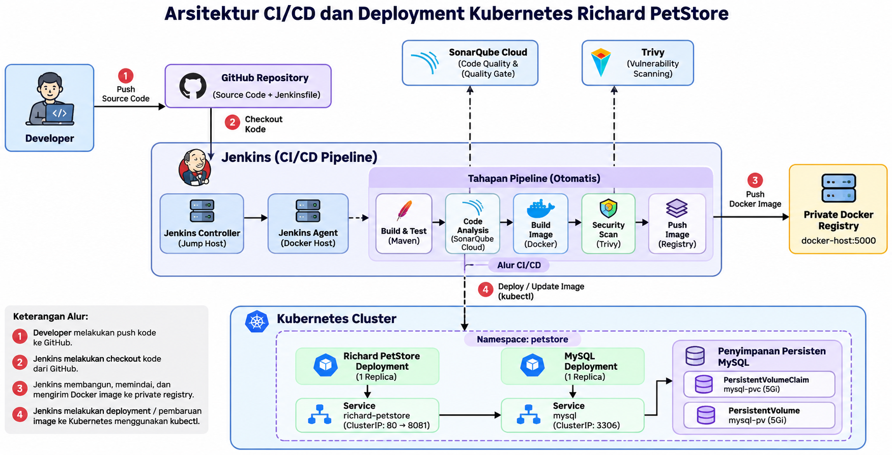
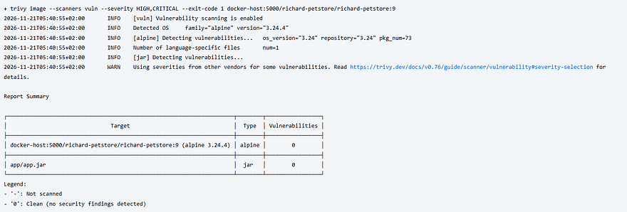

# RICHARD PETSTORE
## Automated CI/CD Pipeline with Kubernetes

**Dokumentasi Proyek DevOps dan DevSecOps**

**Repository GitHub:** https://github.com/RichardAkbar/devsecops-3-tier-cicd-pipeline

**Lingkungan Praktik:** KodeKloud CI/CD Sandbox

**Kategori Proyek:** DevOps, DevSecOps, CI/CD, Docker, Kubernetes

---

# 1. Gambaran Umum Proyek

Richard PetStore merupakan aplikasi web toko kebutuhan hewan peliharaan yang dikembangkan menggunakan Spring Boot dan Java 21. Aplikasi ini dirancang untuk dijalankan dalam lingkungan container dan dikelola menggunakan Kubernetes.

Proyek ini berfokus pada implementasi proses Continuous Integration dan Continuous Deployment (CI/CD) secara otomatis menggunakan Jenkins sebagai alat utama untuk mengelola seluruh tahapan pengiriman aplikasi.

Dalam implementasinya, Jenkins terintegrasi dengan GitHub sebagai tempat penyimpanan source code, Maven untuk proses build dan testing, SonarQube Cloud untuk analisis kualitas kode, Docker untuk containerization, Trivy untuk pemindaian kerentanan, serta Kubernetes untuk deployment dan pengelolaan aplikasi.

Aplikasi Richard PetStore menggunakan MySQL sebagai database dan private Docker Registry sebagai tempat penyimpanan Docker image sebelum digunakan oleh Kubernetes.

Melalui proyek ini, proses pengembangan hingga deployment aplikasi dapat dilakukan secara lebih terstruktur, otomatis, dan terintegrasi.

# 2. Latar Belakang Proyek

Dalam pengembangan aplikasi modern, proses build, testing, pemeriksaan keamanan, dan deployment perlu dilakukan secara konsisten untuk mengurangi kesalahan akibat proses manual.

Pengelolaan aplikasi secara manual juga dapat menyulitkan proses pembaruan versi aplikasi, terutama ketika aplikasi harus dijalankan dalam lingkungan container dan dikelola menggunakan sistem orkestrasi.

Oleh karena itu, proyek Richard PetStore dikembangkan untuk menerapkan alur kerja CI/CD yang mengintegrasikan berbagai teknologi DevOps dan DevSecOps.

Jenkins digunakan untuk mengotomatisasi proses pengiriman aplikasi, mulai dari pengambilan source code hingga deployment ke Kubernetes. SonarQube Cloud dan Trivy ditambahkan untuk mendukung pemeriksaan kualitas kode dan keamanan container image sebelum aplikasi dijalankan.

Dengan implementasi ini, proyek menunjukkan bagaimana proses pengembangan aplikasi dapat diintegrasikan dengan otomatisasi build, pengujian, pemindaian keamanan, containerization, dan deployment.

# 3. Tujuan Proyek

Tujuan utama proyek ini adalah:

1. Mengembangkan aplikasi web Richard PetStore menggunakan Spring Boot dan Java 21.
2. Menerapkan otomatisasi CI/CD menggunakan Jenkins.
3. Mengintegrasikan GitHub sebagai tempat penyimpanan source code dan Jenkinsfile.
4. Mengotomatisasi proses build dan testing menggunakan Maven.
5. Mengintegrasikan SonarQube Cloud untuk analisis kualitas kode.
6. Menerapkan containerization menggunakan Docker.
7. Melakukan pemindaian kerentanan Docker image menggunakan Trivy.
8. Mengelola dan menyimpan Docker image menggunakan private Docker Registry.
9. Melakukan deployment aplikasi secara otomatis ke Kubernetes.
10. Mengonfigurasi MySQL beserta penyimpanan data persisten.
11. Menerapkan Jenkins Credentials dan Kubernetes RBAC untuk mengelola akses secara lebih aman.

# 4. Desain dan Arsitektur Sistem

## 4.1 Gambaran Arsitektur

Arsitektur Richard PetStore menggunakan Jenkins sebagai pusat otomatisasi CI/CD yang terintegrasi dengan GitHub, SonarQube Cloud, Docker Registry, dan Kubernetes.

Proses dimulai ketika Jenkins mengambil source code dan Jenkinsfile dari repository GitHub. Selanjutnya, Jenkins menjalankan tahapan build, testing, analisis kualitas kode, pembuatan Docker image, dan pemindaian keamanan.

Setelah seluruh tahapan yang dikonfigurasi berhasil dilewati, Docker image dikirimkan ke private Docker Registry.

Jenkins kemudian berkomunikasi dengan Kubernetes API Server untuk memperbarui image pada Deployment aplikasi Richard PetStore.

Di dalam Kubernetes, aplikasi Spring Boot dan database MySQL dijalankan sebagai workload terpisah. Aplikasi berkomunikasi dengan MySQL melalui Kubernetes Service, sedangkan data database disimpan menggunakan PersistentVolume dan PersistentVolumeClaim.

## 4.2 Diagram Arsitektur


**Gambar 1. Arsitektur CI/CD dan Deployment Kubernetes Richard PetStore**



## 4.3 Komponen Arsitektur

| Komponen | Fungsi |
|---|---|
| GitHub | Menyimpan source code dan Jenkinsfile |
| Jenkins Controller | Mengelola dan mengatur proses pipeline |
| Jenkins Agent | Menjalankan proses build, scanning, Docker, dan deployment |
| Maven | Melakukan build dan testing aplikasi |
| SonarQube Cloud | Menganalisis kualitas kode dan Quality Gate |
| Docker | Membuat container image aplikasi |
| Trivy | Memindai kerentanan pada Docker image |
| Private Docker Registry | Menyimpan Docker image |
| Kubernetes | Mengelola container dan deployment aplikasi |
| Spring Boot | Menjalankan aplikasi web dan backend |
| MySQL | Menyimpan data aplikasi |
| PersistentVolume | Menyediakan penyimpanan data persisten |

# 5. Teknologi yang Digunakan

Berikut teknologi yang digunakan dalam implementasi proyek:

| Kategori | Teknologi |
|---|---|
| Framework Aplikasi | Spring Boot |
| Bahasa Pemrograman | Java 21 |
| Build Tool | Apache Maven |
| Database | MySQL 8.4 |
| Frontend | Thymeleaf, HTML, Bootstrap |
| Version Control | Git |
| Source Code Repository | GitHub |
| CI/CD | Jenkins |
| Code Quality Analysis | SonarQube Cloud |
| Containerization | Docker |
| Security Scanning | Trivy |
| Container Registry | Private Docker Registry |
| Container Orchestration | Kubernetes |
| Container Runtime | containerd |
| Sistem Operasi | Ubuntu Linux |
| Lingkungan Praktik | KodeKloud CI/CD Sandbox |

# 6. Persiapan Lingkungan dan Infrastruktur

## 6.1 KodeKloud CI/CD Sandbox

Implementasi proyek dilakukan menggunakan KodeKloud CI/CD Sandbox sebagai lingkungan praktik.

Lingkungan ini terdiri dari beberapa komponen utama:

- **Jump Host:** Digunakan sebagai lingkungan Kubernetes control plane sekaligus tempat Jenkins Controller dijalankan.
- **Docker Host:** Digunakan sebagai Jenkins Agent untuk menjalankan perintah Maven, Docker, Trivy, dan kubectl.
- **Kubernetes Cluster:** Digunakan untuk menjalankan aplikasi Richard PetStore dan database MySQL.
- **Private Docker Registry:** Digunakan untuk menyimpan Docker image yang dibuat oleh Jenkins.

## 6.2 Persiapan Perangkat dan Tools

Docker Host dipersiapkan dengan perangkat yang diperlukan untuk menjalankan pipeline, yaitu:

- Java 21
- Apache Maven
- Docker
- Trivy
- kubectl

Selain itu, konfigurasi koneksi antara Jenkins Agent, Docker Registry, dan Kubernetes juga dipersiapkan agar seluruh tahapan pipeline dapat dijalankan.


# 7. Pengembangan Aplikasi

## 7.1 Aplikasi Richard PetStore

Richard PetStore merupakan aplikasi web toko kebutuhan hewan peliharaan yang dikembangkan menggunakan Spring Boot dan Java 21.

Aplikasi menggunakan Thymeleaf dan Bootstrap untuk membangun antarmuka pengguna, sedangkan MySQL digunakan sebagai database relasional.

Fitur aplikasi yang dikembangkan meliputi:

- Halaman utama toko.
- Navigasi kategori dan produk.
- Pengelolaan produk.
- REST API untuk operasi data produk.
- Integrasi database menggunakan Spring Data JPA.
- Endpoint kesehatan aplikasi menggunakan Spring Boot Actuator.

## 7.2 Arsitektur Aplikasi

Secara umum, proses kerja aplikasi adalah:

1. Pengguna mengakses aplikasi melalui antarmuka web.
2. Spring Boot menerima dan memproses permintaan pengguna.
3. Backend berkomunikasi dengan database MySQL.
4. Data produk dikelola melalui backend dan REST API.
5. Hasil pemrosesan ditampilkan kembali melalui antarmuka aplikasi.

Aplikasi berjalan pada port `8081` di dalam container.

## 7.3 Verifikasi Startup Aplikasi

Setelah aplikasi dijalankan, proses inisialisasi diperiksa melalui application startup logs.

Log menunjukkan proses inisialisasi beberapa komponen, antara lain:

- Inisialisasi JPA EntityManagerFactory.
- Inisialisasi embedded Tomcat.
- Startup aplikasi Spring Boot.
- Inisialisasi DispatcherServlet.

Potongan log yang terlihat:

```text
Tomcat started on port 8081
Started RichardPetStoreApplication
```

Hasil tersebut menunjukkan bahwa aplikasi berhasil menyelesaikan proses startup.


*Gambar 3. Log startup aplikasi Richard PetStore yang menunjukkan inisialisasi JPA, embedded Tomcat pada port 8081, dan keberhasilan startup aplikasi.*

## 7.4 Tampilan Halaman Utama Aplikasi

Halaman utama Richard PetStore menampilkan antarmuka storefront yang menjadi halaman awal ketika pengguna mengakses aplikasi.

Komponen antarmuka yang terlihat meliputi:

- Logo dan nama Richard PetStore.
- Navigasi Home, Categories, Products, dan About.
- Bagian pengenalan aplikasi.
- Deskripsi singkat mengenai produk kebutuhan hewan peliharaan.
- Tombol Explore Products.
- Gambar visual hewan peliharaan.


*Gambar 4. Tampilan halaman utama Richard PetStore setelah aplikasi berhasil dijalankan.*

# 8. Containerization Menggunakan Docker

## 8.1 Pembuatan Docker Image

Docker digunakan untuk mengemas aplikasi Spring Boot ke dalam container image agar aplikasi dapat dijalankan secara konsisten pada lingkungan yang berbeda.

Dockerfile aplikasi menggunakan Eclipse Temurin 21 JRE Alpine sebagai base image.

Konfigurasi container mencakup:

- Java 21 Runtime.
- File aplikasi JAR.
- Penggunaan user non-root.
- Expose port 8081.
- Perintah untuk menjalankan aplikasi Spring Boot.

Docker image yang dihasilkan kemudian digunakan oleh Kubernetes untuk menjalankan aplikasi.

## 8.2 Private Docker Registry

Private Docker Registry digunakan sebagai tempat penyimpanan Docker image hasil proses build Jenkins.

Alamat registry:

```text
docker-host:5000
```

Repository image:

```text
richard-petstore/richard-petstore
```

Image diberi tag berdasarkan nomor build Jenkins dan juga menggunakan tag `latest`.

## 8.3 Autentikasi dan Pengiriman Docker Image

Jenkins menggunakan credentials yang tersimpan di Jenkins Credentials untuk melakukan autentikasi ke private Docker Registry.

Autentikasi dilakukan menggunakan perintah `docker login` dengan opsi `--password-stdin` agar password tidak dituliskan secara langsung di dalam perintah.

Setelah autentikasi berhasil, Jenkins mengirimkan Docker image ke registry menggunakan perintah `docker push`.


*Gambar 5. Proses autentikasi Jenkins ke private Docker Registry dan keberhasilan pengiriman Richard PetStore image versi 9.*

**Catatan keamanan:** Pada proses ini Docker menampilkan peringatan bahwa data autentikasi disimpan tanpa enkripsi di file konfigurasi Docker lokal. Untuk lingkungan produksi, penyimpanan tersebut sebaiknya menggunakan credential helper atau mekanisme penyimpanan kredensial yang lebih aman.

# 9. Konfigurasi dan Deployment Kubernetes

## 9.1 Namespace Kubernetes

Namespace bernama `petstore` dibuat untuk memisahkan resource aplikasi Richard PetStore dari workload Kubernetes lainnya.

Namespace ini digunakan untuk mengelola resource aplikasi dan database secara terpisah.

## 9.2 Deployment MySQL

MySQL 8.4 dijalankan sebagai workload terpisah di dalam Kubernetes.

Konfigurasi database terdiri dari:

- MySQL Deployment.
- MySQL ClusterIP Service.
- PersistentVolume.
- PersistentVolumeClaim.
- Kubernetes Secret untuk kredensial database.

Database yang digunakan aplikasi bernama `petstore`.

## 9.3 Konfigurasi Persistent Storage

Penyimpanan persisten dikonfigurasi agar data database tidak bergantung pada siklus hidup Pod MySQL.

Konfigurasi storage yang digunakan:

| Resource | Konfigurasi |
|---|---|
| PersistentVolume | `mysql-pv` |
| PersistentVolumeClaim | `mysql-pvc` |
| Kapasitas | 5Gi |
| Access Mode | ReadWriteOnce |
| Reclaim Policy | Retain |
| Jenis Storage | HostPath |
| Status | Bound |

PersistentVolumeClaim berhasil terhubung dengan PersistentVolume melalui status `Bound`.

## 9.4 Deployment Aplikasi

Aplikasi Spring Boot dijalankan menggunakan Kubernetes Deployment dengan nama:

```text
richard-petstore
```

Deployment dikonfigurasi menggunakan satu replica.

Aplikasi diekspos melalui Kubernetes Service dengan tipe ClusterIP.

Konfigurasi Service:

| Parameter | Nilai |
|---|---|
| Nama Service | `richard-petstore` |
| Tipe | ClusterIP |
| Service Port | 80 |
| Target Port | 8081 |

Deployment aplikasi juga dilengkapi konfigurasi resource requests dan limits, image pull credentials, database credentials, serta health probes.

## 9.5 Konfigurasi Kubernetes RBAC

Role-Based Access Control (RBAC) diterapkan untuk mengatur hak akses Jenkins ketika melakukan deployment ke Kubernetes.

Komponen RBAC yang digunakan:

- ServiceAccount: `jenkins-deployer`
- Role: `jenkins-deployer`
- RoleBinding: `jenkins-deployer`

Role memberikan izin yang diperlukan untuk membaca dan memperbarui resource Deployment pada namespace `petstore`.

Dengan konfigurasi tersebut, Jenkins dapat melakukan deployment menggunakan akun khusus tanpa harus menggunakan akses administrator cluster.

## 9.6 Verifikasi Resource Kubernetes

Setelah seluruh resource diterapkan, dilakukan pemeriksaan untuk memastikan aplikasi dan database berjalan sesuai konfigurasi.

Hasil pemeriksaan yang terlihat:

| Resource | Status |
|---|---|
| MySQL Deployment | Ready 1/1 |
| Richard PetStore Deployment | Ready 1/1 |
| MySQL Pod | Running 1/1 |
| Richard PetStore Pod | Running 1/1 |
| MySQL Service | ClusterIP |
| Richard PetStore Service | ClusterIP |
| MySQL PersistentVolume | Bound |
| MySQL PersistentVolumeClaim | Bound |


*Gambar 6. Pemeriksaan resource Kubernetes yang menunjukkan Deployment aplikasi dan MySQL, Service, Pod, serta persistent storage.*

# 10. Implementasi Jenkins CI/CD Pipeline

## 10.1 Konfigurasi Jenkins Pipeline

Jenkins dikonfigurasi untuk mengambil definisi pipeline secara langsung dari repository GitHub menggunakan fitur Pipeline script from SCM.

Konfigurasi yang digunakan:

| Parameter | Nilai |
|---|---|
| Definition | Pipeline script from SCM |
| SCM | Git |
| Repository | `RichardAkbar/devsecops-3-tier-cicd-pipeline` |
| Branch | `main` |
| Jenkinsfile | `Jenkinsfile` |

Dengan pendekatan ini, Jenkins mengambil Jenkinsfile dari repository GitHub sehingga konfigurasi pipeline tersimpan bersama source code dan dapat dikelola menggunakan Git.

Pendekatan ini dikenal sebagai Pipeline as Code.


*Gambar 7. Konfigurasi Jenkins Pipeline yang mengambil Jenkinsfile dari repository GitHub pada branch main.*

## 10.2 Pengelolaan Jenkins Credentials

Jenkins Credentials digunakan untuk menyimpan informasi autentikasi yang dibutuhkan selama proses pipeline.

Kredensial yang terlihat pada konfigurasi Jenkins meliputi:

| Credential ID | Jenis | Fungsi |
|---|---|---|
| `docker-host-ssh-creds` | Username and Password | Akses SSH ke Docker Host |
| `my-kube-config-credentials` | Secret File | File konfigurasi Kubernetes |
| `kubernetes-deployer-token` | Secret Text | Autentikasi deployment Kubernetes |
| `jenkins-richard-petstore` | Secret Text | Token autentikasi SonarQube |
| `docker-registry-credentials` | Username and Password | Autentikasi private Docker Registry |

Seluruh informasi sensitif disimpan melalui Jenkins Credentials dan tidak dituliskan secara langsung di dalam Jenkinsfile.


*Gambar 8. Konfigurasi Jenkins Global Credentials untuk mengelola akses Docker Host, Docker Registry, Kubernetes, dan integrasi layanan.*

## 10.3 Integrasi Jenkins dengan SonarQube Cloud

Jenkins diintegrasikan dengan SonarQube Cloud untuk menjalankan analisis kualitas kode secara otomatis.

Konfigurasi server yang digunakan:

| Parameter | Nilai |
|---|---|
| Nama Instalasi | `SonarQubeCloud` |
| Server URL | `https://sonarcloud.io` |
| Authentication | Jenkins Credentials |

Jenkinsfile menggunakan nama instalasi tersebut untuk mengakses konfigurasi SonarQube ketika menjalankan tahap analisis.


*Gambar 9. Konfigurasi integrasi Jenkins dengan SonarQube Cloud.*

## 10.4 Tahapan Jenkins Pipeline

Pipeline Jenkins terdiri dari beberapa tahapan utama.

| Tahap | Fungsi |
|---|---|
| Checkout | Mengambil source code dari GitHub |
| Verify Environment | Memeriksa Java, Maven, Docker, Trivy, dan kubectl |
| Build and Test | Melakukan build dan testing menggunakan Maven |
| SonarQube Analysis | Melakukan analisis kualitas kode dan Quality Gate |
| Docker Build | Membuat Docker image aplikasi |
| Trivy Security Scan | Memindai kerentanan Docker image |
| Docker Push | Mengirimkan image ke private registry |
| Deploy to Kubernetes | Memperbarui Deployment aplikasi pada Kubernetes |

Melalui tahapan tersebut, proses pengiriman aplikasi dapat dijalankan secara otomatis mulai dari pengambilan source code hingga deployment.

# 11. Analisis Kualitas Kode dan Keamanan

## 11.1 Analisis Awal Menggunakan SonarQube Cloud

SonarQube Cloud digunakan untuk melakukan analisis source code dan mengidentifikasi masalah kualitas kode maupun potensi masalah keamanan.

Pada analisis awal, ditemukan tiga issues yang masih terbuka.

Temuan tersebut meliputi:

1. Dockerfile menggunakan `root` sebagai user default.
2. Elemen HTML membutuhkan atribut `integrity` dan `crossorigin="anonymous"`.
3. Elemen HTML lainnya juga membutuhkan atribut `integrity` dan `crossorigin="anonymous"`.

Ketiga temuan tersebut ditampilkan dengan tingkat severity Low pada halaman SonarQube.


*Gambar 10. Hasil analisis awal SonarQube Cloud yang menunjukkan tiga issues sebelum perbaikan.*

## 11.2 Perbaikan Issues

Temuan yang dihasilkan dari analisis awal kemudian ditinjau dan dilakukan perbaikan.

Setelah proses perbaikan, halaman Issues pada SonarQube menunjukkan pesan:

```text
No Issues. Hooray!
```

Jumlah issues yang ditampilkan berkurang dari tiga menjadi nol.

| Indikator | Sebelum | Sesudah |
|---|---:|---:|
| Open Issues | 3 | 0 |
| Estimasi Effort | 25 menit | 0 |


*Gambar 11. Hasil analisis SonarQube Cloud setelah perbaikan yang menunjukkan tidak ada issues pada tampilan tersebut.*

## 11.3 Validasi Quality Gate

Setelah integrasi SonarQube Cloud dikonfigurasi, Jenkins menjalankan tahap analisis kode melalui pipeline.

Hasil eksekusi menunjukkan:

```text
QUALITY GATE STATUS: PASSED
SonarScanner Engine completed successfully
BUILD SUCCESS
```

Hasil tersebut menunjukkan bahwa proses analisis berhasil diselesaikan dan Quality Gate memperoleh status PASSED.


*Gambar 12. Hasil eksekusi analisis SonarQube melalui Jenkins dengan status Quality Gate PASSED.*

## 11.4 Pemindaian Kerentanan Menggunakan Trivy

Trivy diintegrasikan ke dalam Jenkins Pipeline untuk melakukan pemindaian kerentanan pada Docker image yang telah dibuat.

Pipeline menjalankan dua pemeriksaan:

1. Pemindaian kerentanan image secara umum.
2. Pemindaian khusus kerentanan dengan severity HIGH dan CRITICAL.

Pemeriksaan kedua menggunakan konfigurasi `--exit-code 1` sehingga pipeline dapat dihentikan apabila ditemukan kerentanan dengan tingkat severity yang ditentukan.

Pada eksekusi pipeline yang telah dilakukan sebelumnya, hasil pemindaian menunjukkan tidak ditemukan kerentanan pada image yang dipindai.

Tahap ini membantu mengidentifikasi potensi kerentanan pada komponen image sebelum aplikasi dideploy.



# 12. Otomatisasi Deployment ke Kubernetes

## 12.1 Pengiriman Docker Image

Setelah image berhasil dibuat dan melewati tahap pemindaian keamanan, Jenkins melakukan autentikasi ke private Docker Registry dan mengirimkan image ke registry.

Image yang terlihat pada screenshot:

```text
docker-host:5000/richard-petstore/richard-petstore:9
```

Image tersebut kemudian dapat digunakan oleh Kubernetes dalam proses deployment.

## 12.2 Autentikasi Jenkins ke Kubernetes

Jenkins menggunakan credential `kubernetes-deployer-token` untuk melakukan autentikasi ke Kubernetes API Server.

Pada tahap deployment, pipeline membuat file kubeconfig sementara dan mengatur beberapa konfigurasi:

- Alamat Kubernetes API Server.
- Certificate Authority.
- Token autentikasi deployment.
- Kubernetes context.
- Namespace tujuan deployment.

Setelah proses selesai, file kubeconfig sementara dihapus melalui mekanisme cleanup.

## 12.3 Pembaruan Docker Image pada Deployment

Jenkins memperbarui image aplikasi pada Kubernetes Deployment menggunakan perintah:

```bash
kubectl set image deployment/richard-petstore \
  richard-petstore=docker-host:5000/richard-petstore/richard-petstore:9 \
  -n petstore
```

Hasil yang ditampilkan:

```text
deployment.apps/richard-petstore image updated
```

Hasil tersebut menunjukkan bahwa referensi image pada Deployment berhasil diperbarui.

## 12.4 Verifikasi Rolling Update

Setelah image diperbarui, Jenkins memeriksa status rollout menggunakan perintah:

```bash
kubectl rollout status deployment/richard-petstore \
  -n petstore --timeout=180s
```

Hasil eksekusi menunjukkan:

```text
deployment "richard-petstore" successfully rolled out
```

Hal ini menunjukkan bahwa Kubernetes berhasil menyelesaikan proses rollout Deployment.


*Gambar 13. Proses Jenkins memperbarui image Richard PetStore ke versi 9 dan memverifikasi keberhasilan rollout Kubernetes.*

# 13. Verifikasi Deployment dan Hasil Akhir

## 13.1 Pemeriksaan Status Deployment

Setelah proses deployment, status aplikasi diperiksa melalui Kubernetes.

Hasil pemeriksaan menunjukkan:

```text
NAME               READY   UP-TO-DATE   AVAILABLE
richard-petstore   1/1     1            1
```

Deployment aplikasi berhasil mencapai kondisi satu replica siap dan tersedia.

## 13.2 Pemeriksaan Status Pod

Hasil pemeriksaan Pod pada saat screenshot diambil menunjukkan:

| Pod | Ready | Status |
|---|---|---|
| MySQL Pod | 1/1 | Running |
| Richard PetStore Pod Baru | 1/1 | Running |
| Richard PetStore Pod Lama | 1/1 | Terminating |

Pod aplikasi yang baru sudah berstatus Running dan Ready 1/1. Sementara itu, Pod lama masih berada dalam proses penghentian.

## 13.3 Hasil Eksekusi Jenkins Pipeline

Hasil akhir eksekusi Jenkins menampilkan pesan:

```text
Richard PetStore CI/CD pipeline and Kubernetes deployment completed successfully!

[Pipeline] End of Pipeline
Finished: SUCCESS
```

Hasil tersebut membuktikan bahwa Jenkins berhasil menyelesaikan seluruh tahapan pipeline yang dikonfigurasi, termasuk tahap deployment Kubernetes.


*Gambar 14. Hasil akhir Jenkins Pipeline yang menunjukkan status SUCCESS setelah proses deployment Kubernetes.*

## 13.4 Hasil Deployment Aplikasi

Halaman utama Richard PetStore berhasil ditampilkan melalui browser.

Tampilan tersebut menjadi bukti visual bahwa aplikasi web dapat diakses setelah proses deployment.


*Gambar 15. Tampilan aplikasi Richard PetStore setelah proses deployment.*


### 16.4 Autentikasi Kubernetes

ServiceAccount khusus dan RBAC dikonfigurasi agar Jenkins memiliki izin yang dibutuhkan untuk melakukan deployment ke namespace `petstore`.

### 16.5 Konsistensi Docker Image

Referensi image pada Kubernetes Deployment disesuaikan dengan repository dan tag image yang dikirimkan oleh Jenkins ke private registry.

### 16.6 Verifikasi Rolling Update

Status rollout diperiksa menggunakan `kubectl rollout status` untuk memastikan Pod aplikasi baru berhasil mencapai kondisi siap.

Proses tersebut memberikan pengalaman langsung dalam menangani integrasi CI/CD, container build, autentikasi registry, dan deployment Kubernetes.

# 17. Kesimpulan

Proyek Richard PetStore berhasil menunjukkan penerapan otomatisasi CI/CD yang terintegrasi dengan containerization, analisis keamanan, dan orkestrasi Kubernetes.

Dengan menggabungkan Jenkins, GitHub, Maven, SonarQube Cloud, Trivy, Docker, dan Kubernetes, proyek ini membangun alur pengiriman aplikasi mulai dari pengambilan source code hingga deployment secara otomatis.

Implementasi ini juga mencakup penggunaan private container registry, Kubernetes RBAC, pemeriksaan kesehatan aplikasi, serta penyimpanan data database secara persisten.

Keberhasilan eksekusi Jenkins Pipeline dan proses rollout Kubernetes menjadi bukti bahwa alur deployment otomatis berhasil dijalankan pada lingkungan KodeKloud CI/CD Sandbox.

Melalui proyek ini, kemampuan praktis dalam bidang DevOps dan DevSecOps semakin berkembang, khususnya dalam otomatisasi CI/CD, pengelolaan container, pemindaian keamanan, dan deployment aplikasi menggunakan Kubernetes.

# 18. Repository Proyek

**GitHub Repository:**

https://github.com/RichardAkbar/devsecops-3-tier-cicd-pipeline

Repository ini berisi source code aplikasi, konfigurasi Jenkins Pipeline, Dockerfile, manifest Kubernetes, serta dokumentasi proyek.

---
